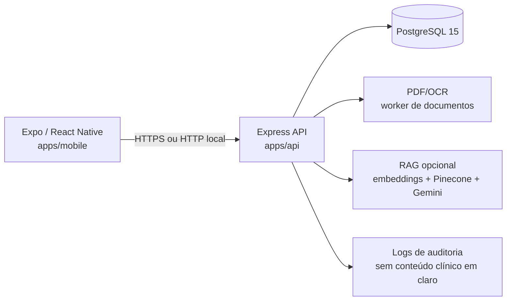

# MyFetus — Documentação técnica v3

**Status:** candidato à documentação de transição e homologação  
**Atualizado em:** 16/11/2026  
**Escopo:** código presente em `main` no momento deste documento  
**Responsável pela aprovação:** PO/Rui

## 1. Objetivo e limites

Este documento permite que uma nova equipe configure, execute, valide e opere o
MyFetus sem depender de conhecimento oral da equipe atual. Ele descreve o
produto acadêmico em homologação, não constitui autorização para uso clínico
real e não substitui validação médica, institucional ou regulatória.

O piloto de usabilidade previsto para 24/11 usa dados sintéticos e não deve
introduzir código novo após o freeze de 23/11. Achados do piloto entram como
limitações conhecidas ou backlog priorizado; um achado P1 aberto impede a
apresentação como beta para teste real.

## 2. Visão da solução



| Componente | Responsabilidade | Fonte principal |
| --- | --- | --- |
| Mobile | Fluxos da gestante e do médico, autenticação local, gráficos e envio de documentos. | `apps/mobile` |
| API | Autenticação JWT, autorização por papel/vínculo, regras clínicas, documentos, relatórios, RAG e exportações. | `apps/api/server.js`, `apps/api/routes`, `apps/api/services` |
| Banco | Dados cadastrais, gestacionais, clínicos, auditoria e controle de migrations. | `apps/api/db` |
| Worker | Extração de PDF, OCR opcional, classificação de status e persistência do resultado. | `apps/api/workers` |
| CI/CD | Lint, testes, CodeQL, imagem Docker e deploy controlado em homologação. | `.github/workflows`, `docs/ci-cd.md` |

Perfis suportados: `gestante`, `medico` e `admin`. A autorização combina o
papel com o vínculo médico-paciente; possuir um token válido não concede acesso
ao prontuário de outra gestante.

## 3. Configuração local

### Pré-requisitos

- Node.js 18 ou superior;
- npm;
- Docker Desktop e Docker Compose;
- Expo Go ou emulador para executar o mobile.

### Fluxo recomendado

```bash
npm run setup
npm run dev:api
# em outro terminal
npm run dev:mobile
```

O `setup` cria `.env` a partir de `.env.example`, gera segredos locais,
instala dependências, sobe o PostgreSQL, aplica migrations e carrega dados
sintéticos. Para uma preparação manual, use `cp .env.example .env`, preencha os
segredos, execute `npm install`, `npm run docker:up`, `npm run db:migrate` e
`npm run seed`.

Serviços locais:

| Serviço | Endereço |
| --- | --- |
| API | `http://localhost:3000` |
| Liveness | `GET /ping` |
| Readiness | `GET /health` |
| Swagger | `http://localhost:3000/docs/` |
| PostgreSQL no host | `localhost:5434` |
| PostgreSQL na rede Docker | `db:5432` |

No celular físico, `EXPO_PUBLIC_API_URL` deve apontar para o IP da máquina na
rede local. Nunca commitamos `.env`, tokens, chaves, arquivos enviados ou
credenciais de cloud.

## 4. Configuração por ambiente

O `.env.example` é a referência de nomes. As variáveis obrigatórias para a API
são `PG_USER`, `PG_PASSWORD`, `PG_DATABASE`, `PG_HOST`, `PORT`, `NODE_ENV`,
`JWT_SECRET`, `AES_KEY_VERSION`, `AES_ENCRYPTION_KEY_V1` e
`EMAIL_LOOKUP_HMAC_KEY`. Em produção/homologação também são necessários
`CORS_ORIGIN`, `TRUST_PROXY` e `ENFORCE_HTTPS=true`.

O RAG é opcional para desenvolvimento básico. RAG real exige Pinecone e Gemini,
com `PINECONE_API_KEY`, `PINECONE_INDEX_NAME`, `PINECONE_NAMESPACE`,
`EMBEDDING_MODEL`/`EMBEDDING_DIMENSION`, `GEMINI_API_KEY` e `GEMINI_MODEL`.
Quando esses serviços não estão configurados, os fluxos que dependem deles
devem ser tratados como indisponíveis, e não como evidência clínica.

## 5. Funcionalidades entregues nesta base

- cadastro, login, consentimento versionado e papéis de acesso;
- acompanhamento de gestação, eventos, medidas e histórico de biometria/peso;
- vínculo entre médico e gestante e dashboard clínico;
- upload de documentos com armazenamento cifrado, extração de texto e OCR;
- parsing de exames laboratoriais, mapeamento LOINC e revisão médica versionada;
- alertas de risco com histórico de reconhecimento/encerramento;
- diário versionado da gestante, com regras de alarme e histórico;
- consultas médicas com adendos, devolutiva médica e relatórios PDF;
- exportação FHIR experimental e direitos LGPD de exportação/exclusão;
- chat clínico/RAG com citações, guardrails e trilhas de avaliação;
- auditoria administrativa, hardening HTTP, rate limit e testes de contrato.

### Fluxo mínimo de demonstração

1. autenticar uma gestante sintética;
2. registrar um item do diário e verificar o alarme;
3. entrar como médico e abrir o alerta no painel;
4. enviar ou consultar um exame, revisar o resultado e publicar a devolutiva;
5. consultar o chat e conferir a citação retornada.

Esse fluxo é uma demonstração acadêmica. Não há autorização para interpretar ou
decidir conduta clínica sem profissional habilitado.

## 6. API e contratos

Todas as rotas de negócio ficam sob `/api`. Os grupos principais são usuários,
consentimentos, gestantes, gestações/eventos, documentos, exames, histórico,
consultas, devolutivas, relatórios, diário, alertas, RAG, auditoria, privacidade
e exportações. O contrato completo está em
[`apps/api/openapi.yaml`](../apps/api/openapi.yaml) e é publicado no Swagger.

Ao alterar uma rota, atualize o OpenAPI no mesmo PR e execute:

```bash
cd apps/api
npm run docs:check
```

## 7. Banco de dados e migrações

O inventário textual de entidades, chaves e relacionamentos está em
[`er-textual-v3.md`](er-textual-v3.md). O executor canônico é
`apps/api/scripts/migrate.js`: aplica cada arquivo em transação, registra a
versão em `schema_migrations` e usa advisory lock para impedir concorrência.

Para volume existente, use `npm run db:migrate`; não recrie o volume para
“atualizar” uma instalação. `npm run docker:reset` é destrutivo e só é adequado
para ambiente local descartável.

## 8. Segurança, privacidade e operação

- senhas são armazenadas com hash; sessões usam JWT;
- dados clínicos e documentos sensíveis usam envelopes AES-GCM e versão de chave;
- busca por e-mail usa HMAC de lookup, sem depender de e-mail em claro;
- arquivos são armazenados cifrados fora do repositório;
- logs sanitizam PII e a auditoria possui política append-only;
- consentimentos, exportação e exclusão seguem as rotas e políticas LGPD do projeto;
- CORS, HTTPS, HSTS, headers de segurança, rate limits e validações são
  configuráveis por ambiente;
- o RAG recebe texto sanitizado e deve retornar citação/limitação quando não
  houver base suficiente; ele não substitui revisão médica.

Segredos de homologação ficam no Secret Manager do provedor. O CI usa OIDC e a
imagem é identificada pelo SHA; migrations e runtime usam a mesma imagem. O
procedimento operacional está em [`docs/ci-cd-gcp-staging.md`](ci-cd-gcp-staging.md)
e o contrato portável em [`docs/ci-cd.md`](ci-cd.md).

## 9. Testes e critérios de avanço

Antes de abrir um MR, execute as verificações aplicáveis:

```bash
# raiz
npm test
npm run test:pdf-extractor

# API
cd apps/api
npm run test:ci
npm run docs:check

# mobile
cd ../mobile
npm run lint
npm run typecheck
npm run test:ci
```

O pipeline também executa auditoria de dependências, CodeQL e build Docker.
Testes E2E mobile são complementares nesta entrega e não são gate obrigatório
para a documentação técnica ou para o freeze de homologação.

## 10. Limitações conhecidas e backlog

| Classificação | Situação | Tratamento |
| --- | --- | --- |
| P1/P2/P3 | A severidade de um achado do piloto é classificada pelo impacto na jornada, exposição de dados ou orientação clínica. | Registrar o achado; P1 bloqueia beta e recebe prioridade. |
| Piloto | Sessões remotas com dados sintéticos, sem gravação; achados pós-freeze não viram código neste ciclo. | Documentar em `Docs v3` e no backlog da próxima equipe. |
| E6-05 / #113 | Papel de enfermagem. | Backlog 2027.1; exige decisão de negócio e escopo de permissão. |
| E8-07 / #116 | Relato científico/pesquisa. | Backlog 2027.1; avaliar CEP antes de pesquisa com participantes. |
| E8-02 | Execução do piloto e parecer final. | Requer condução do PO e registro da limitação se não houver cinco participantes. |
| #135 | PDF de consulta. | Dívida conhecida; não declarar como entregue sem implementação validada. |
| #132 | Push efetivo. | O registro de token existe; opt-in/envio real permanecem dependentes de produto/infra. |
| RAG | Base de conhecimento e quotas externas dependem de fontes aprovadas e configuração de serviços. | Não usar conteúdo não aprovado; operar com gate/limitação explícita. |
| Produção | Não existe ambiente produtivo habilitado. | Homologação não deve receber dados reais. |

## 11. Perguntas e sugestões de resposta

As perguntas abaixo ficam documentadas para a passagem de contexto; não são
novos bloqueios técnicos desta documentação.

**Pergunta:** quais achados do piloto devem virar correção imediata?  
**Sugestão de resposta:** a equipe classifica P1/P2/P3; Rui confirma P1. P1
bloqueia beta, P2 recebe workaround/documentação e P3 pode entrar no backlog.

**Pergunta:** o que fazer com achados observados depois do freeze?  
**Sugestão de resposta:** não alterar o build congelado; registrar o achado em
`Docs v3` e no backlog 2027.1, com prioridade e evidência.

**Pergunta:** quais fontes podem entrar no RAG?  
**Sugestão de resposta:** somente fontes clínicas aprovadas pelo PO e registradas
no manifesto; sem aprovação, manter o gate fechado e não afirmar cobertura.

**Pergunta:** podemos chamar esta versão de produção?  
**Sugestão de resposta:** não. A versão é acadêmica, de homologação e com dados
sintéticos; qualquer uso real exige nova decisão institucional e regulatória.

**Pergunta:** qual é o prazo desta documentação?  
**Sugestão de resposta:** revisão e aprovação do PO até 24/11, acompanhando o
freeze de 23/11 e o piloto de 24/11.

## 12. Checklist de transição

- [ ] clonar o repositório e executar `npm run setup`;
- [ ] confirmar que nenhum `.env`, segredo ou dado real está no repositório;
- [ ] validar `/ping`, `/health` e `/docs/`;
- [ ] conferir `schema_migrations` após aplicar migrations;
- [ ] rodar API, raiz e mobile checks aplicáveis;
- [ ] revisar `openapi.yaml` junto com alterações de rota;
- [ ] registrar decisões novas em `docs/adr`;
- [ ] registrar achados do piloto como issue, com severidade e evidência;
- [ ] usar [`docs/er-textual-v3.md`](er-textual-v3.md) e
  [`docs/ci-cd.md`](ci-cd.md) como referências de continuidade;
- [ ] confirmar transferência de repositório, GCP, Expo e localização dos
  secrets no checklist da issue #185, sem copiar os valores.
