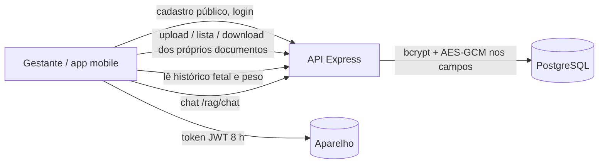
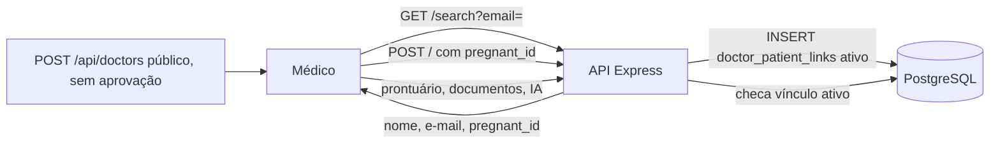
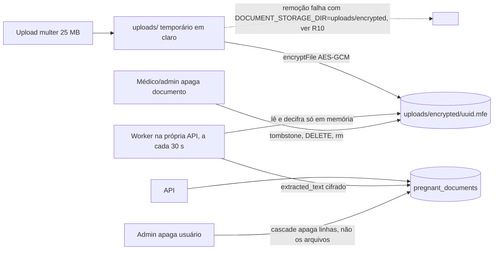
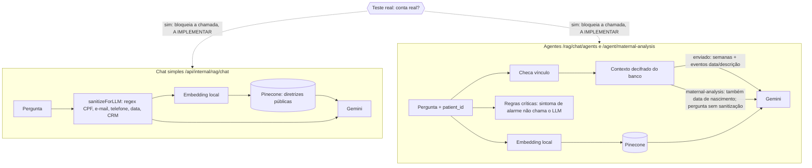

# DPIA simplificada e registro de riscos de privacidade — MyFetus

> **Task:** E7-04.1 (subtask de #69) · **Dependências:** #50, #56, #114 · **Relacionadas:** #145 (direitos do titular), #115 (tela Sobre / canal "Fale com a equipe"), #146 (decisões do P.O.)
> **Status:** RASCUNHO v1.1 — decisões do P.O. registradas; **não marcar como concluída antes da revisão e do aceite final do P.O.**

| Campo | Valor |
| --- | --- |
| Versão | 1.1 |
| Data | 24/10/2026 |
| Autor(es) | João Guilherme |
| Revisor (P.O.) | ruypontes |
| Status da revisão | Decisões do P.O. registradas (#146); aceite final pendente |

## Legenda

- **[CONFIRMADO]**: verificado no código, nas migrations, no banco em execução, nos testes ou confirmado pelo P.O. (a evidência vem entre parênteses).
- **[DECISÃO-PO]**: decisão registrada pelo P.O. na issue #146 (Sprint 4).
- **[SUPOSIÇÃO]**: não confirmado; deve constar também na seção 8.
- **[PENDENTE-PO]**: decisão que depende do P.O.
- **[A VERIFICAR]**: depende de arquivo ou teste ainda não analisado.
- **[A IMPLEMENTAR]**: controle decidido, mas que ainda não existe no código ou no processo.

**Glossário**

- **Teste real**: uso do sistema com dados reais de gestantes e médicos (piloto). É o marco que os riscos altos bloqueiam.
- **Conta sintética**: conta de teste com dados fictícios. O critério técnico para identificá-la ainda não existe (S21).

**Fontes analisadas:** schema base, migrations (Sprints 1, 3, 6, AES, segurança de documentos, security baseline, audit trail), `init.sql`, `docker-compose.yml`, estado real do banco local (`\d`, após `db:migrate`), `package.json`, e no backend: `server.js`, `config/dataClassification.js`, `config/security.js`, `middlewares/auth.js`, `middlewares/authRateLimit.js`, `utils/clinicalAccess.js`, `utils/logger.js`, `utils/piiSanitizer.js`, `utils/ragRetrieval.js`, rotas (`users`, `doctors`, `pregnants`, `documents`, `doctorPatientLinks`, `rag`, `agent`, `growth`, `clinicalHistory`, `medicoes`), controllers (`user`, `pregnant`, `documents`, `doctorPatientLink`, `rag`, `agent`), serviços (`cryptoService`, `fileCryptoService`, `auditService`, `clinicalDataService`, `documentExtractionWorker`, `generationService`, `embeddingService`, `ragIngestionService`, agentes e `clinicalGraph`), `utils/userPolicy.js`, `middlewares/userAccess.js`, `controllers/doctorController.js`, `controllers/clinicalHistoryController.js`, `services/pdfTextExtractor.js` (extração/OCR), `routes/audit.js`, `routes/sync.js`, `routes/pregnancies.js`, `routes/pregnancyEvents.js`, `routes/health.js`, `controllers/auditController.js`, `controllers/syncController.js`, `controllers/pregnancyController.js`, `controllers/pregnancyEventsController.js`, `services/clinicalHistoryService.js`, `services/healthService.js`.

**Analisados na segunda rodada:** `utils/syncPolicy.js`, `routes/docs.js`, `controllers/documentsController.js` (inteiro), `server.js` (inteiro), `routes/documents.js` (inteiro), valor de `DOCUMENT_STORAGE_DIR` (`uploads/encrypted`), versões resolvidas de `pdfjs-dist` (4.10.38) e `tesseract.js` (6.0.1) no `package-lock.json`, busca por "admin" nos scripts da API (só `generate-jwt-test-token.js`) e, no mobile, por busca de linhas, `utils/sessionStorage.ts`, `utils/scopedStorage.ts` e `app/(tabs)/exames.tsx`.

**Ainda não analisados:** o conteúdo de `openapi.yaml`, o trecho de `sessionStorage.ts` que guarda o token (destino do token), o conteúdo gravado por `scopedStorage.ts`, o restante do app mobile (a busca de `console.*` cobriu só um nível de pastas), o download dos dados de idioma do `tesseract.js` em tempo de execução, a origem do primeiro admin (nenhum script encontrado) e como recuperar ou reconfigurar `AES_ENCRYPTION_KEY_V1` (ver R06)

**Execução dos testes (máquina do desenvolvedor, banco local):**

| Comando | Resultado | Observação |
| --- | --- | --- |
| `npm run test:ci` | **Passou** (código 0) | Cobre `piiSanitizer`, `logger`, `cryptoService`, `fileCryptoService`, `securityBaseline`, `crossPatientAuthorization`, `clinicalDataService`, `emailLookupService`, `generationService`, `openapiContract`, worker de documentos |
| `test:pii`, `test:logger`, `test:crypto`, `test:file-crypto`, `test:clinical-crypto`, `test:security-baseline` | **Passaram** (código 0 em cada um) | Execução individual |
| `npm run test:transport-security` | **Passou** (com o `.env` carregado) | Saída: "HTTPS e rate limiting validados". A primeira tentativa falhou só por `PG_USER` ausente no ambiente |
| `npm run aes:migrate:dry-run` | **Não concluiu** (código 1), mesmo após carregar o `.env` | Conectou ao banco e varreu 5 registros (2 usuários, 1 médico, 1 gestante com as colunas classificadas vazias [CONFIRMADO: consulta SQL], 1 documento), mas falhou em todos por `AES_ENCRYPTION_KEY_V1 nao configurada`; a variável `AES_ENCRYPTION_KEY_V1` existe, mas está **vazia** (0 caracteres) no `.env` e no contêiner da API (ver R06). A contagem de legados foi obtida por consulta SQL (ver R11) |

---

## Registro de decisões do P.O. (Sprint 4)

Fonte: comentário do P.O. (ruypontes) na issue #146, em resposta às 8 perguntas da atualização da Sprint 4. Estas decisões prevalecem sobre as propostas anteriores deste documento.

| # | Tema | Decisão do P.O. | Efeito neste documento |
| --- | --- | --- | --- |
| 1 | Riscos críticos | **Mitigar.** Não aceito risco alto residual. | Nenhum risco alto pode ter decisão "Aceitar". Todos os altos (nível ≥ 6) estão como **Mitigar** na seção 4. Isso inclui o R12 (históricos em texto plano), que antes admitia "aceitar com justificativa". |
| 2 | Responsáveis | **Aprovar.** Titular e substituto por categoria. Clínica e Privacidade: o P.O. Segurança e Infraestrutura: a equipe indica os nomes na issue. | Seção 6 reorganizada nas 4 categorias. Nomes de Segurança e Infraestrutura **pendentes** (S23). |
| 3 | Prazo de mitigação | **Aprovar.** Risco alto bloqueia o **teste real**; médio fecha antes dele; baixo vai para o backlog. | Coluna "Prazo (regra)" da seção 4 aplica esta regra a cada risco. |
| 4 | Retenção de dados clínicos | **Mitigar.** Dados sintéticos e contas de teste são apagados no fim do ciclo, menos os seeds. No teste real, os dados ficam enquanto a conta existir, e a titular exporta ou exclui quando quiser (#145). Aceites e auditoria ficam até o fim do projeto. | Seção 7 e coluna "Retenção" do inventário. Depende da #145 (controle ainda a implementar). |
| 5 | Arquivos e backups | **Aprovar.** A política avisa que a exclusão só chega ao backup quando ele expira. (A sugestão aprovada: mesma finalidade e retenção do dado original, acesso restrito, descarte auditável e grace period antes de qualquer deleção.) | Seção 7 e R13/R16. O prazo de expiração do backup **não foi definido** (S22). |
| 6 | IA e terceiros | **Ajustar.** O Gemini gratuito pode usar o conteúdo enviado. No teste real, o chat de IA fica desligado para contas reais até o primeiro contrato; segue ativo só para contas sintéticas. O Pinecone guarda só trechos das diretrizes. Custo zero. | R01, R07, D21, D22, seção 3.4 e 3.5. Controle ainda a implementar (S21). |
| 7 | Menores de idade | **Aprovar.** Sem menores; cadastro abaixo de 18 anos bloqueado no servidor. | R14 e S08. Controle ainda a implementar. |
| 8 | Incidentes | **Aprovar.** Canal: "Fale com a equipe" do app (#115). Contenção em 24 h e registro sem PII. Com dado real, comunicação à ANPD e aos titulares em até 3 dias úteis. | Novo R21 e seção 7.1. Depende da #115. |

**Regra de classificação (decisões 1 e 3):** nível = P × I; 1–2 baixo (backlog), 3–4 médio (fecha antes do teste real), 6–9 alto (bloqueia o teste real). Para risco alto não existe aceite formal; só a mitigação libera o teste real.

---

## 1. Escopo e contexto

- Sistema: MyFetus, app mobile (Expo/React Native), API Node.js/Express, PostgreSQL 15 (Docker), extração de texto de documentos e chat clínico com RAG.
- Titulares: gestantes, médicos/profissionais de saúde, administradores. O feto/recém-nascido aparece nos dados (biometria, nascidos vivos/mortos), mas não é usuário. **Menores de 18 anos não fazem parte do público** [DECISÃO-PO 7].
- Natureza do tratamento: dados pessoais e **dados pessoais sensíveis de saúde** (LGPD, art. 5º, II), incluindo HIV/AIDS, sífilis, toxoplasmose, uso de álcool/tabaco/drogas, perdas gestacionais e informações psicossociais.
- Terceiros: **Google Gemini** recebe a pergunta, semanas de gestação e eventos em texto livre (ver 3.4); **Pinecone** guarda apenas diretrizes públicas e recebe vetores de consulta. Embeddings são gerados localmente (`Xenova/multilingual-e5-small`) [CONFIRMADO: `embeddingService.js`, `ragIngestionService.js`, `generationService.js`]. Pela decisão 6, **no teste real o chat de IA fica desligado para contas reais**; só contas sintéticas usam Gemini e Pinecone.
- Ambiente: desenvolvimento/acadêmico, sem produção [CONFIRMADO: README]. Os riscos valem para o teste real com dados reais.
- Fora de escopo: [SUPOSIÇÃO] deploy de produção (não implementado), análise do código do app mobile (ver "Ainda não analisados") e gestantes menores de 18 anos (excluídas do piloto, decisão 7).

## 2. Inventário de dados

"AES" = coluna convertida para `TEXT` para guardar envelope AES-256-GCM `vN:iv:cipher:tag` e listada em `ENCRYPTED_FIELDS` [CONFIRMADO: `\d`, `dataClassification.js`, `cryptoService.js`]. No banco local, a contagem de registros legados em texto plano foi medida por consulta SQL: nenhum (ver R11). Em outros ambientes ainda não foi medida.

Retenção: a regra geral por tipo de dado está na seção 7 [DECISÃO-PO 4].

| ID | Dado | Tabela.colunas | Titular | Classificação | Finalidade (proposta) | Base legal | Quem acessa | Proteção em repouso | Retenção |
| --- | --- | --- | --- | --- | --- | --- | --- | --- | --- |
| D01 | Identificação | `users.name`, `email`, `birthdate` | Todos | Pessoal | Cadastro e autenticação | [SUPOSIÇÃO] | Próprio usuário; **admin lista todos (`GET /users`)**; médico via busca por e-mail (R03); `birthdate` vai ao Gemini no `/agent/maternal-analysis` (só contas sintéticas no teste real); médico vinculado lê e edita name e birthdate via /users/:id (requireUserAccess, userPolicy) | AES; `email_lookup_hash` HMAC-SHA-256 (índice único); `email` sem UNIQUE | Seção 7 |
| D02 | Credencial e perfil | `users.password`, `role`, `is_active` | Todos | Pessoal | Autenticação/autorização | [SUPOSIÇÃO] | API | `password` com bcrypt (10 rounds) [CONFIRMADO: `userController.js`, `HASHED_FIELDS`]; `role`/`is_active` em claro | Seção 7 |
| D03 | Perfil profissional | `doctors.crm`, `crm_estado`, `telefone`, `especialidade` | Médico | Pessoal | Identificação profissional | [SUPOSIÇÃO] | Admin | AES em crm/crm_estado/telefone; `especialidade` em claro | Seção 7 |
| D04 | Antropometria e sinais vitais | `pregnants.altura`, `peso_*`, `temperatura_materna`, `pressao_*` | Gestante | **Sensível (saúde)** | Pré-natal | [SUPOSIÇÃO] | Médico vinculado; admin | AES | Seção 7 |
| D05 | Antecedentes | `pregnants.antecedentes_*`, `antecedentes_clinicos_*` (inclui textos livres) | Gestante | **Sensível (saúde)** | Estratificação de risco | [SUPOSIÇÃO] | Médico vinculado; admin | AES | Seção 7 |
| D06 | Histórico obstétrico | `pregnants.gestacao_*` | Gestante | **Sensível (saúde)**; perdas gestacionais | Estratificação de risco | [SUPOSIÇÃO] | Médico vinculado; admin | AES | Seção 7 |
| D07 | Gestação atual: hábitos e infecções | `pregnants.gestacao_atual_*` (fumante, álcool, drogas, HIV/AIDS, sífilis, toxoplasmose etc.), `exantema_rash` | Gestante | **Sensível (saúde) — impacto muito alto** | Acompanhamento | [SUPOSIÇÃO] | Médico vinculado; admin. **Não vai ao Gemini** no código atual [CONFIRMADO: `buildPatientContext`] | AES | Seção 7 |
| D08 | Vacinas | `pregnants.vacina_*` | Gestante | **Sensível (saúde)** | Acompanhamento | [SUPOSIÇÃO] | Médico vinculado; admin | AES | Seção 7 |
| D09 | Informações gerais e psicossociais | `pregnants.info_gerais_*` (texto livre) | Gestante | **Sensível (saúde/psicossocial)** | Avaliação clínica | [SUPOSIÇÃO] | Médico vinculado; admin | AES | Seção 7 |
| D10 | Dados da gestação | `pregnancies.weeks`, `dum`, `dpp`, `ccn`, `dgm`, `glicemia`, `frequencia_cardiaca`, `altura_uterina`, `regularidade_do_ciclo`, `ig_ultrassonografia`, `is_checked` | Gestante | **Sensível (saúde)** | Acompanhamento | [SUPOSIÇÃO] | Gestante; médico vinculado; **semanas vão ao Gemini** (só contas sintéticas no teste real) | AES | Seção 7 |
| D11 | Eventos gestacionais | `pregnancy_events.descricao` (texto livre), `data_evento` | Gestante | **Sensível (saúde)**; texto livre pode ter PII | Registro clínico | [SUPOSIÇÃO] | Gestante (leitura via GET /pregnancyEvents) e médico vinculado; admin; **vão ao Gemini sem sanitização** (agente materno; só contas sintéticas no teste real) | AES | Seção 7 |
| D12 | Medidas fetais (tabela base) | `medidas_fetais.ccn`, `crl`, `dgn`, `idade_gestacional_semanas` | — | **Não identifica pessoa**: sem chave para gestante/gestação [CONFIRMADO: `\d`, `routes/medicoes.js`] | Cálculo de comprimento fetal | — | Médico/admin (escrita) | AES | — |
| D13 | Biometria fetal (histórico) | `fetal_biometry_history`: `dbp_mm`, `cc_mm`, `ca_mm`, `cf_mm`, pesos, `percentile`, `z_score`, `notes`, `measured_at`, `created_by_user_id` | Gestante/feto | **Sensível (saúde)** | Curvas de crescimento | [SUPOSIÇÃO] | Gestante; médico | **Texto plano**: colunas `numeric`/`date`/`integer` e tabela fora de `ENCRYPTED_FIELDS` [CONFIRMADO] | Sem exclusão exposta pela API; deleted_at existe mas não é usado; seção 7 |
| D14 | Peso materno (histórico) | `maternal_weight_history.weight_kg`, `notes`, `measured_at`, `created_by_user_id` | Gestante | **Sensível (saúde)** | Acompanhamento | [SUPOSIÇÃO] | Gestante; médico | **Texto plano** [CONFIRMADO] | Sem exclusão exposta pela API; deleted_at existe mas não é usado; seção 7 |
| D15 | Documentos e exames | `pregnant_documents`: `document_name`, `document_type`, `file_path`, `extracted_text`, `extraction_*`, `report_comment`, `status`, `reviewed_*`; arquivo em disco | Gestante | **Sensível (saúde)** | Armazenar, extrair e revisar exames | [SUPOSIÇÃO] | Gestante (upload/lista/download dos próprios); médico vinculado/admin | AES nos campos de texto; arquivo `.mfe` AES-GCM; `file_path` em claro; texto extraído cifrado | Excluir documento remove linha e arquivo; seção 7 |
| D16 | Vínculo médico–paciente | `doctor_patient_links.doctor_id`, `pregnant_id`, `status` | Gestante e médico | Pessoal (relação de cuidado) | Controle de acesso | [SUPOSIÇÃO] | API | Em claro (ids) | Seção 7; **sem consentimento da gestante** (R03) |
| D17 | Metadados técnicos | `created_at`, `updated_at`, `version`, `deleted_at`, `encryption_key_version` | Todos | Técnico | Sincronização, versionamento | — | API | — | — |
| D18 | Catálogo LOINC | `loinc_codes` | — | **Sem dado pessoal** | Normalizar termos de exames | — | API | — | — |
| D19 | Trilha de auditoria | `audit_logs`: `actor_id`, `actor_role`, `action`, `resource`, `resource_id`, **`ip_address`** (do `X-Forwarded-For`), **`user_agent`**, `outcome`, `detail` (JSONB: `pregnant_id`, `patient_id`, `fields`, `sanitized_query` do chat) | Usuários | **Pessoal** (IP, acesso a prontuário) | Auditoria | [SUPOSIÇÃO] | Admin (`/api/admin/audit`) | Em claro; regras do banco bloqueiam UPDATE/DELETE | **Até o fim do projeto** [DECISÃO-PO 4]; minimização de IP/user agent pendente (S17) |
| D20 | Logs de aplicação | stdout da API (`logger`), com `body` se `LOG_REQUESTS=true` | Todos | Variável | Operação | [SUPOSIÇÃO] | DevOps | Sanitização por regex | [PENDENTE-PO] |
| D21 | Dados enviados ao Gemini | Pergunta (sanitizada por regex, **exceto** no `/agent/maternal-analysis`), trechos de diretrizes, **semanas de gestação**, **eventos (data + descrição livre)** e, só no `/agent/maternal-analysis`, **data de nascimento** [CONFIRMADO: `generationService.buildPatientContext`, `ragController`, `agentController`] | Gestante/médico | **Sensível (saúde)** | Chat clínico | [SUPOSIÇÃO] | Google | Em trânsito (TLS). O Gemini gratuito pode usar o conteúdo enviado [DECISÃO-PO 6] | **No teste real, nenhum dado de conta real é enviado** (chat desligado para contas reais, [A IMPLEMENTAR]); só contas sintéticas |
| D22 | Vetores de consulta | Embedding da pergunta enviado ao Pinecone | Usuários | Derivado de texto | Busca semântica | [SUPOSIÇÃO] | Pinecone | — | Mesma regra de D21: [SUPOSIÇÃO] inclui `/rag/search` no bloqueio para contas reais (S21) |
| D23 | Arquivos em disco | `uploads/encrypted/*.mfe` (definitivos) e `uploads/` (temporários em claro durante o upload) | Gestante | **Sensível (saúde)** | Armazenar exames | [SUPOSIÇÃO] | Contêiner da API | `.mfe` cifrado; **o temporário em claro NÃO é removido com a configuração atual (R10)**; o worker de extração lê o arquivo decifrado só em memória [CONFIRMADO]; o OCR trabalha só em memória (PNG em buffer), sem temporários [CONFIRMADO] | **Não é removido ao excluir usuário (R13)**; arquivos órfãos seguem a regra da seção 7 |
| D24 | Sessão no aparelho | Token JWT (8 h por padrão) no app | Todos | Pessoal | Sessão | [SUPOSIÇÃO] | Aparelho | O app remove a chave legada do token no `AsyncStorage`, o que indica que o token foi movido; **o destino atual do token não foi visto** (ex.: armazenamento seguro) [A VERIFICAR]. O objeto do usuário (JSON) fica no `AsyncStorage`, sem cifra, no aparelho [CONFIRMADO: `sessionStorage.ts`]. Dados por usuário usam chaves com escopo (`scopedStorage.ts`); o que é gravado ali é [A VERIFICAR]. O logout remove as chaves de sessão [CONFIRMADO] | — |

**Observações do inventário**

- O schema efetivo é `create_tables.sql` + migrations, na ordem do `docker-compose.yml`. `init.sql` está **divergente** (usa `role IN ('user','admin')`, `deleted_at`, `version`) e não é montado no compose; convém removê-lo ou marcá-lo como obsoleto.
- Não há `deleted_at` em `users`, `pregnants`, `pregnancies`, `pregnancy_events` e `pregnant_documents` no banco real: a exclusão é definitiva (cascade).
- Os arquivos definitivos ficam em `uploads/encrypted` dentro de `./apps/api`, montado como bind mount [CONFIRMADO: `docker-compose.yml`]. O `.gitignore` ignora `apps/api/uploads/*` (linha 17) e `.env` (linha 12), e não há arquivo rastreado em `apps/api/uploads` nem `.env` no histórico [CONFIRMADO: `git check-ignore -v`, `git ls-files`, `git log --all`]. A persistência em produção segue [A VERIFICAR] (S15).
- O Postgres publica a porta `5434` no host e a API a `3000`.
- Nenhum caminho de código visto envia o texto extraído dos documentos ao Gemini [CONFIRMADO nos arquivos analisados, incluindo `pdfTextExtractor.js`]. O OCR é local (`pdfjs-dist` e `tesseract.js`, sem `fetch`/`http` no arquivo), renderiza as páginas em buffers de memória (`@napi-rs/canvas`) e não grava arquivos temporários nem registra o texto em log [CONFIRMADO: `pdfTextExtractor.js`]. O arquivo não define `langPath`/`cachePath`: pela configuração padrão da biblioteca, os dados de idioma (`por+eng`) podem ser baixados de um CDN na primeira execução [A VERIFICAR: teste em ambiente sem internet; versão resolvida 6.0.1, e a busca por `langPath`/`cachePath`/`createWorker` em `pdfTextExtractor.js` não retornou linhas].
- `users.birthdate` permite aplicar o bloqueio de cadastro de menores de 18 anos no servidor (decisão 7, R14). Se `birthdate` for opcional no cadastro, o bloqueio precisa torná-lo obrigatório [A VERIFICAR: `userController.js`].

## 3. Mapa de fluxos

### 3.1 Fluxo da gestante

A gestante **não** atualiza seus dados clínicos depois de criados (`PUT /pregnants/:id` é só médico/admin), mas grava valores clínicos ao criar a gestação (`POST /pregnancies`, R18). Ela também não exclui documentos nem a própria conta (R18); a exportação e a exclusão pela titular são o objetivo da #145 [DECISÃO-PO 4, A IMPLEMENTAR]. No cadastro, **menores de 18 anos devem ser bloqueados no servidor** [DECISÃO-PO 7, A IMPLEMENTAR]. No teste real, o chat da gestante com conta real fica desligado [DECISÃO-PO 6, A IMPLEMENTAR].

### 3.2 Fluxo do médico e vínculo

O cadastro de médico é público e "por enquanto sem aprovação de admin" [CONFIRMADO: comentário em `routes/doctors.js`], e o vínculo é criado unilateralmente, sem aprovação da gestante (R03). A decisão 1 do P.O. exige autorização e consentimento vigente para mitigar esse risco [DECISÃO-PO 1, A IMPLEMENTAR].

### 3.3 Fluxo de documentos

### 3.4 Fluxo de IA

Achados confirmados no código:

- O prompt do agente materno usa só `birthdate`, `latest_pregnancy.weeks` e `all_events` (data e descrição). Campos como HIV, drogas ou antecedentes **não** são enviados ao Gemini hoje; se `buildPatientContext` for ampliado, o risco R01 aumenta.
- `/rag/chat/agents`: remove nome, e-mail, telefone e nascimento do contexto (`removePatientIdentifiers`) e sanitiza a pergunta no grafo; o texto livre dos eventos segue sem tratamento.
- `/agent/maternal-analysis`: **não sanitiza nada**; envia `birthdate`, eventos e a pergunta crua.
- `/rag/search`, `/rag/chat` e `/rag/chat/agents` exigem só autenticação (qualquer papel) e não têm rate limit; `/agent/maternal-analysis` tem rate limit e papel médico/admin, mas **não gera auditoria**.
- `clinicalGraph.js` desvia para "avaliação humana" (sem chamar o LLM) quando a pergunta casa com sintomas de alarme, e pede esclarecimento quando é vaga.
- O erro devolve `error.message` ao cliente nessas rotas (relevante para E7-05.1).

**Decisão do P.O. (6) e o que ela exige no código [A IMPLEMENTAR]:** no teste real, `/rag/chat`, `/rag/chat/agents` e `/agent/maternal-analysis` (e, por [SUPOSIÇÃO], `/rag/search`, que envia o vetor da pergunta ao Pinecone) devem recusar contas reais e atender só contas sintéticas. Isso depende de um critério técnico para identificar a conta sintética (S21). A sanitização de PII (R01) continua necessária para quando houver contrato e o chat for reativado.

### 3.5 Terceiros e operadores

| Terceiro | Dados enviados | Localização | Contrato/DPA | Status |
| --- | --- | --- | --- | --- |
| Google (Gemini, `gemini-2.5-flash`) | Ver D21. **Plano gratuito: o Google pode usar o conteúdo enviado** [DECISÃO-PO 6] | [SUPOSIÇÃO] fora do Brasil | **Sem contrato.** O chat só é reativado para contas reais após o primeiro contrato (avaliação de transferência incluída) | Confirmado no código; bloqueio para contas reais [A IMPLEMENTAR] |
| Pinecone | Diretrizes públicas (PDFs em `data/guidelines`) e **vetores das perguntas** | [SUPOSIÇÃO] fora do Brasil | Sem contrato; custo zero [DECISÃO-PO 6] | Guarda só trechos das diretrizes, sem dados de pacientes [CONFIRMADO: `ragIngestionService.js`; DECISÃO-PO 6] |
| Hugging Face (modelo de embeddings) | Nenhum dado de paciente: baixa o modelo na primeira execução; inferência local | — | — | [A VERIFICAR] cache do modelo |
| CDN dos dados de idioma do Tesseract (`tesseract.js`) | Nenhum dado de paciente: só baixa `por/eng` na primeira execução; OCR local | --- | --- | Versão resolvida 6.0.1 [CONFIRMADO: lockfile]. `pdfTextExtractor.js` não define `langPath`/`cachePath`, então vale o padrão da biblioteca [A VERIFICAR: download na primeira execução e cache em disco; se pode ser embarcado no contêiner] |

## 4. Matriz de risco

Escala: Probabilidade (P) e Impacto (I) de 1 a 3; Nível = P × I (1–2 baixo, 3–4 médio, 6–9 alto). **Os valores de P e I são propostas [SUPOSIÇÃO] a validar com o P.O.** A coluna "Prazo (regra)" aplica a decisão 3: alto bloqueia o teste real; médio fecha antes dele; baixo vai para o backlog. A coluna "Decisão" aplica a decisão 1: nenhum risco alto é aceito. A coluna "Categoria" indica a categoria responsável (seção 6); os nomes ficam na seção 6.

| ID | Ameaça | Dado/fluxo | P | I | Nível | Prazo (regra) | Decisão | Mitigação | Categoria | Status |
| --- | --- | --- | --- | --- | --- | --- | --- | --- | --- | --- |
| R01 | Dado pessoal enviado ao Gemini sem sanitização suficiente: `birthdate`, eventos em texto livre e pergunta crua no `/agent/maternal-analysis`; sanitização é só regex e não remove nomes em texto livre. O Gemini gratuito pode usar o conteúdo enviado [DECISÃO-PO 6] | D21, 3.4 | 3 | 2 | 6 | Alto: bloqueia o teste real | **Mitigar** | **Chat de IA desligado para contas reais no teste real, ativo só para contas sintéticas [DECISÃO-PO 6, A IMPLEMENTAR]**. Antes de reativar para contas reais: contrato, avaliação de transferência (R07), sanitizar contexto e pergunta antes de qualquer chamada ao LLM e enviar faixa etária em vez de `birthdate` | Privacidade | Mitigação decidida; controle a implementar |
| R02 | PII ou dado clínico em logs, doctorController.js passa o e-mail cru ao logger (logger.error(..., { email })); o mascaramento depende só da regex do piiSanitizer [CONFIRMADO]. | D20 | 2 | 3 | 6 | Alto: bloqueia o teste real | **Mitigar** | Logger sanitizado existe e passa no `test:ci`; manter `LOG_REQUESTS=false`; E7-06 (lint contra `console.*`) | Segurança | Parcial |
| R03 | **Acesso indevido ao prontuário**: cadastro de médico público e sem aprovação [CONFIRMADO]; qualquer `medico` busca gestante por e-mail (recebe nome e e-mail) e cria vínculo com qualquer `pregnant_id`, sem consentimento da gestante; `ensureCanAccessPregnant` responde 404 (não existe) ou 403 (não vinculada), o que permite enumerar IDs. A enumeração é confirmada: clinicalAccess.js responde 404 para ID inexistente e 403 com mensagem própria para não vinculado, para gestação (linhas 103-106) e gestante (67-70, 88-90), e pregnancyEventsController.js:71 responde 404 antes de checar o acesso a eventos [CONFIRMADO]; `documentsController.js` repete o padrão: 404 para documento inexistente e 403 com mensagem própria para médico não vinculado [CONFIRMADO]; Além de ler, o médico vinculado edita name e birthdate da gestante (LINKED_DOCTOR_UPDATE_FIELDS) [CONFIRMADO: userPolicy.js] | D16, D04–D15 | 3 | 3 | 9 | Alto: bloqueia o teste real | **Mitigar** (risco residual alto não é aceito) | Exigir autorização e consentimento vigente da gestante para o vínculo; auditoria; revisão periódica dos vínculos [DECISÃO-PO 1]; validação de CRM/aprovação de admin no cadastro; limitar e auditar a busca; resposta única para ID inexistente e não vinculado; resposta única 403 também em gestações e eventos | Segurança | Aberto; mitigação decidida |
| R04 | Controle de acesso incompleto: `/rag/*` sem papel e sem rate limit; `medicoes` e `search` de gestantes sem rate limit; erros devolvem `error.message`. `growth` já exige autenticação e tem rate limit [CONFIRMADO], o 409 "Email já cadastrado" em createDoctor permite enumerar contas (mitigado pelo limite de 5 cadastros por 15 min); `GET /health` é público e expõe status, versão e latência do banco e do Pinecone, sem dado pessoal; cada chamada faz `SELECT 1` e `describeIndexStats` no Pinecone, sem rate limit [CONFIRMADO: healthService.js]; nenhuma rota do pacote5 declara rate limit, vale o que server.js monta por prefixo; server.js não define limite global [CONFIRMADO: leitura completa de server.js]; `/docs` (Swagger UI, `openapi.json` e `openapi.yaml`) é público, com rate limit próprio (padrão 300 por janela) e sem acesso ao banco, e expõe o contrato completo da API (rotas e schemas); o conteúdo do `openapi.yaml` ainda é [A VERIFICAR]; `/health` e `/ping` são públicos e sem rate limit; `server.js` não usa Helmet (nenhum header de segurança além do HSTS de `requireHttps`; `x-powered-by` fica ativo) e **não define handler global de erro**: o erro de CORS ("Origin não permitido") e JSON inválido caem no handler padrão do Express, que fora de produção devolve o stack trace [CONFIRMADO no código; testar com `curl -i -H "Origin: http://x.com" http://localhost:3000/api/users`]; `trust proxy` só é ativado se `TRUST_PROXY` estiver definido; pregnancyController.js (linhas 79, 109, 148) e pregnancyEventsController.js (39, 64, 104) devolvem error.message; `documentsController.js` também devolve `error.message` em `getDocuments`, `getDocumentById`, `updateDocument`, `getDocumentExtractedText` e `retryDocumentTextExtraction` (upload, download, exclusão e relatório já usam mensagem genérica) [CONFIRMADO]; um :id não numérico faz o Postgres lançar erro de sintaxe, que chega ao cliente como 500 com a mensagem do banco [CONFIRMADO no código; testar]. | API | 2 | 2 | 4 | Médio: fecha antes do teste real | **Mitigar** | Papel e rate limit por rota; mensagens de erro genéricas (E7-05.1); adicionar Helmet, desligar `x-powered-by` e criar handler global de erro sem stack trace; avaliar restringir `/docs` fora de ambiente de desenvolvimento | Segurança | Parcial (E7-05.1) |
| R05 | Retenção e descarte indefinidos (dados clínicos, auditoria, logs) | Todos | 3 | 2 | 6 | Alto: bloqueia o teste real | **Mitigar** | Regras de retenção por tipo definidas pelo P.O. (seção 7) [DECISÃO-PO 4]. Falta: rotina técnica de descarte dos dados sintéticos ao fim do ciclo (exceto seeds), exclusão pela titular (#145), prazo de logs de aplicação (D20) e prazo de expiração dos backups (S22) | Privacidade | Regras decididas; controles a implementar |
| R06 | Perda ou vazamento de chaves (JWT, AES, HMAC, senha do banco), mantidas em `.env`. **No ambiente local, `AES_ENCRYPTION_KEY_V1` está vazia no `.env` e no contêiner da API, embora existam registros cifrados**: sem a chave original, esses dados e o documento `.mfe` ficam irrecuperáveis. A API só valida `JWT_SECRET` na inicialização; a chave AES é lida no primeiro uso, então o servidor sobe sem ela e falha depois [CONFIRMADO: `config/security.js`, `cryptoService.js`]. Não há procedimento documentado de guarda e recuperação das chaves [A VERIFICAR]. O `.env` está no `.gitignore` e não consta no histórico do git [CONFIRMADO], então o risco de vazamento pelo GitHub é baixo; permanece o risco de perda e a falta de cofre. | Segredos | 2 | 3 | 6 | Alto: bloqueia o teste real | **Mitigar** | Já existem: `JWT_SECRET` com ao menos 32 caracteres, chaves AES validadas quando usadas, scripts de rotação (`jwt:rotate`, `db:rotate-password`, versões AES). Falta: validar chaves AES e HMAC na inicialização, guardar e fazer backup das chaves em cofre de segredos, definir responsável nominal e procedimento de recuperação | Segurança | Aberto |
| R07 | Transferência internacional de dados clínicos ao Gemini (LGPD art. 33); o cadastro de médico só valida formato (CRM não vazio e UF com 2 letras), sem unicidade possível (CRM cifrado com IV aleatório) nem verificação, então qualquer pessoa pode se cadastrar com o CRM de outro médico [CONFIRMADO: doctorController.js]. | D21, 3.5 | 2 | 3 | 6 | Alto: bloqueia o teste real | **Mitigar** | Contra a transferência: no teste real nenhum dado de conta real vai ao Gemini (chat desligado, [DECISÃO-PO 6, A IMPLEMENTAR]); só há base, contrato e avaliação de transferência antes de reativar; minimizar o que é enviado (R01). Contra o CRM falso: validar/aprovar o cadastro de médico (R03, S12) | Privacidade | Mitigação decidida; controle a implementar |
| R08 | Consentimento não coletado nem registrado; não há tabela ou campo de consentimento no schema | D01–D15 | 3 | 3 | 9 | Alto: bloqueia o teste real | **Mitigar** | Definir base legal e registrar aceite (versão do termo, data, finalidade). A decisão 1 exige consentimento vigente para o acesso ao prontuário [DECISÃO-PO 1]; o modelo ainda não foi definido (S01, S04) | Privacidade | Aberto |
| R09 | Resposta de IA clínica usada sem revisão humana | 3.4 | 2 | 2 | 4 | Médio: fecha antes do teste real | **Mitigar** | Já existem: regras críticas que impedem a chamada ao LLM, prompts proibindo diagnóstico, temperatura 0,2; reforçar o aviso na UI. No teste real com contas reais o chat está desligado (R01), o que reduz a exposição | Clínica | Parcial |
| R10 | Exposição de documentos: sem lista de tipos permitidos nem antivírus; temporário em claro durante o upload; upload/download sem rate limit; pasta de armazenamento dentro do diretório da API (ignorada pelo git; o risco restante é a persistência em produção), o OCR e o pdfjs processam PDF não confiável no processo da API sem limite de páginas, tempo ou escala (loop até numPages, scale 2 por padrão), e o pdfjs é aberto sem isEvalSupported:false [CONFIRMADO: pdfTextExtractor.js]; package.json pede pdfjs-dist ^4.10.38, acima da correção do CVE-2024-4367 (4.2.67) [CONFIRMADO]; o lockfile resolve a versão 4.10.38 [CONFIRMADO]; ainda assim passar isEvalSupported:false é boa prática. `document_type` é controlado pelo cliente (no upload vem de `req.body.document_type` ou do mimetype declarado; o app mobile o envia em `exames.tsx`; também é editável em `updateDocument`) e é usado como Content-Type no download (`res.type`) [CONFIRMADO]. O download usa `res.attachment(...)` (Content-Disposition: attachment), o que reduz bastante o risco de o navegador renderizar conteúdo ativo; falta `X-Content-Type-Options: nosniff` (sem Helmet) [CONFIRMADO]. **Falha confirmada no código (o temporário em claro não é removido):** o multer grava o upload em `uploads/` (`routes/documents.js`, sem filtro de tipo) e o limpador do controller usa `DOCUMENT_STORAGE_DIR=uploads/encrypted` como raiz; o temporário fica fora dessa raiz, o limpador o recusa (log "Skipping file cleanup outside allowed directory") e o arquivo em claro permanece em `uploads/`, tanto nos uploads bem-sucedidos quanto nos rejeitados [CONFIRMADO: controller, rota e valor da variável; falta só o teste em execução]. Como o multer grava o arquivo (até 25 MB) antes da checagem de acesso do controller, o cadastro de gestante é público e a rota não tem rate limit, qualquer conta nova pode encher o disco [CONFIRMADO no código]. Arquivos `.delete-<uuid>` ficam órfãos se o processo cair entre o rename e o DELETE [CONFIRMADO no código]. O reprocessamento (`/extract`) não tem limite além do papel | D15, D23 | 3 | 3 | 9 | Alto: bloqueia o teste real | **Mitigar** | Validar tipo/assinatura; volume dedicado em produção; rate limit, limitar páginas, dimensões e tempo do OCR; isEvalSupported:false; embarcar os dados de idioma do Tesseract, lista fixa de tipos aceitos; derivar o tipo do conteúdo (assinatura do arquivo), não do cliente; no download manter Content-Disposition: attachment (já existe) e acrescentar X-Content-Type-Options: nosniff (Helmet); **corrigir já** a limpeza (a raiz de limpeza deve cobrir o diretório do multer e o de armazenamento), apagar os temporários em claro já acumulados em `uploads/`, acrescentar teste de regressão (após o upload, nenhum arquivo solto em `uploads/`), usar `fileFilter` e rate limit na rota de upload, e varrer arquivos `.delete-*` órfãos. | Segurança | Parcial |
| R11 | Registros legados em texto plano: `decrypt` aceita texto sem prefixo `vN:` sem alertar; migração só oportunística (no login ou na busca por e-mail). No banco local, `users` (2 de 2), `doctors` (1 de 1) e `pregnant_documents` (1 de 1) estão no formato de envelope AES; a única linha de `pregnants` está com as colunas classificadas vazias [CONFIRMADO: consulta SQL], logo não há texto plano legado nem dado cifrado nessa tabela; o `aes:migrate:dry-run` varreu 5 registros mas não concluiu (R06). Resultado: nenhum registro legado em texto plano no banco local. Como `pregnants` não tem dados, a cifragem dessa tabela só está evidenciada por teste (`test:clinical-crypto`), não por dado real; as atualizações parciais (updatePregnancy, updatePregnancyEvent, sync) sobrescrevem encryption_key_version da linha com a versão atual mesmo recifrando só parte das colunas; o envelope vN preserva a leitura, mas o metadado deixa de refletir as colunas antigas e pode enganar o aes:migrate [CONFIRMADO no código; critério do migrate [A VERIFICAR]]. | D01–D15 | 1 | 3 | 3 | Médio: fecha antes do teste real | **Mitigar** | Rodar `aes:migrate:dry-run` em cada ambiente com dados reais antes de usá-lo; alertar ao ler texto plano | Segurança | Parcial (sem legado no banco local); pregnants (sem dados; outros ambientes não medidos) |
| R12 | **Históricos fetal e de peso materno em texto plano** no banco (colunas numéricas e tabelas fora de `ENCRYPTED_FIELDS`); notes é texto livre de até 2000 caracteres gravado em texto plano, sem sanitização [CONFIRMADO: clinicalHistoryService.js:42-54]; SELECT * devolve também created_by_user_id e deleted_at ao cliente. | D13, D14 | 3 | 2 | 6 | Alto: bloqueia o teste real | **Mitigar** (aceite não é possível para risco alto, decisão 1) | Cifrar (mudar tipos e incluir as tabelas em `ENCRYPTED_FIELDS`); parar de devolver `created_by_user_id` e `deleted_at` ao cliente; sanitizar `notes` | Segurança | Aberto (confirmado); cifragem a implementar |
| R13 | **Exclusão de usuário** (`DELETE /users/:id`, admin) apaga linhas por cascade, mas nenhum código remove os arquivos `.mfe`, e a ação não é auditada; a coluna deleted_at dos históricos não é preenchida por nenhum código analisado (sem endpoint de exclusão) | D13–D15, D23 | 3 | 2 | 6 | Alto: bloqueia o teste real | **Mitigar** | Excluir arquivos ao apagar usuário/gestante; auditar; purgar `deleted_at` antigos; arquivos órfãos seguem a mesma finalidade e retenção do dado original, com acesso restrito, descarte auditável e grace period antes de qualquer deleção [DECISÃO-PO 5] | Privacidade | Aberto (confirmado) |
| R14 | Gestantes menores de 18 anos (LGPD art. 14) | D01 | 2 | 3 | 6 | Alto: bloqueia o teste real | **Mitigar** | **Sem menores no piloto; cadastro abaixo de 18 anos bloqueado no servidor** [DECISÃO-PO 7, A IMPLEMENTAR]: validar `birthdate` em `POST /users` (e demais rotas que criem ou editem `birthdate`) com teste de regressão; tornar `birthdate` obrigatório se hoje for opcional. Menores só voltam ao produto com regra jurídica e fluxo de autorização específico | Privacidade | Mitigação decidida; controle a implementar |
| R15 | Texto livre em `detail` da auditoria (`sanitized_query` do chat) e em logs, com sanitização só por regex; o cadastro grava o e-mail normalizado no detail da auditoria (userController.js:173), mascarado só se o sanitizador o cobrir [A VERIFICAR] | D19, D20 | 2 | 2 | 4 | Médio: fecha antes do teste real | **Mitigar** | Registrar só metadados (tamanho, rota); não guardar o texto da pergunta | Segurança | Aberto |
| R16 | Backups e infraestrutura: o compose só define o volume `db_data`, sem rotina de backup; porta 5434 publicada no host; HTTPS só é exigido com `NODE_ENV=production` ou `ENFORCE_HTTPS=true`; `test:transport-security` passou (valida HTTPS obrigatório e rate limiting); TLS entre API e banco não verificado; `server.js` executa `ALTER TABLE` e `CREATE TABLE IF NOT EXISTS` na inicialização (self-healing), então o usuário do banco da API tem privilégio de DDL, o que contraria o menor privilégio [CONFIRMADO: server.js] | D20, 3.x | 2 | 3 | 6 | Alto: bloqueia o teste real | **Mitigar** | Backup cifrado e com acesso restrito; não publicar a porta do banco em produção; mover o DDL da inicialização para migrations e usar usuário de aplicação sem privilégio de DDL. Política de backup [DECISÃO-PO 5]: mesma finalidade e retenção do dado original, acesso restrito, descarte auditável e grace period; a política de privacidade avisa que a exclusão só chega ao backup quando ele expira; definir o prazo de expiração (S22) | Infraestrutura | Aberto |
| R17 | **Auditoria incompleta ou com falha silenciosa**: registro assíncrono que só loga erro; `audit_logs` não existia no banco local até `db:migrate`; `doctorPatientLinkController` chama `audit()` sem importá-lo [A VERIFICAR]; sem auditoria em `maternal-analysis`, busca de gestante, remoção de vínculo, `DELETE /users`, `GET /users` (admin), `GET /pregnants/:id` e na maior parte das leituras de documento (upload, download, exclusão e relatório são auditados; **listagem, consulta por id, texto extraído, atualização de metadados e reprocessamento não são** [CONFIRMADO: documentsController.js]); o IP vem do `X-Forwarded-For` sem validar proxy confiável (falsificável; `server.js` só ativa `trust proxy` quando `TRUST_PROXY` está definido), sem auditoria em createDoctor, em todo o clinicalHistoryController (leitura e criação de D13/D14) e no requireUserAccess (acessos de admin e do médico vinculado a /users/:id) [CONFIRMADO: ausência de audit( nesses arquivos], sem audit() em pregnancyController, pregnancyEventsController, syncController e auditController, nem na leitura em massa do admin [CONFIRMADO: ausência de audit( nesses arquivos]. | D19 | 3 | 2 | 6 | Alto: bloqueia o teste real | **Mitigar** | Importar `audit`; auditar leituras clínicas, ações de admin e o agente; alerta de falha de auditoria; usar `req.ip` com `trust proxy` configurado. A auditoria é mantida até o fim do projeto [DECISÃO-PO 4]; aceites também | Segurança | Aberto |
| R18 | Titular sem canal para exercer direitos (art. 18): a gestante não pode apagar documento nem a própria conta (`DELETE /users` é só admin), não corrige dados clínicos (`PUT /pregnants`, `PUT /pregnancies/:id` e `PUT /pregnancyEvents/:id` só médico/admin) e não há exportação [CONFIRMADO nas rotas analisadas]. A gestante cria gestação (`POST /pregnancies`) e nesse ato grava `ccn`, `dgm`, `glicemia`, `frequencia_cardiaca`, `altura_uterina` e `is_checked`, sem validação de tipo ou faixa [CONFIRMADO: pregnancyController.js:11-50]; é problema de exatidão dos dados (LGPD art. 6º, V), e o significado de `is_checked` é [A VERIFICAR]. Os históricos fetal e de peso não têm exclusão exposta pela API [CONFIRMADO: clinicalHistoryController/Service]. | D01–D15 | 3 | 2 | 6 | Alto: bloqueia o teste real | **Mitigar** | Entregar a exportação e a exclusão controladas pela titular (#145) [DECISÃO-PO 4]; validar tipo e faixa dos valores clínicos criados pela gestante; expor exclusão dos históricos fetal e de peso. P, I, nível e mitigação deste risco estavam em branco na versão anterior; os valores são propostas [SUPOSIÇÃO] | Privacidade | Aberto; depende da #145 |
| R19 | Sessão: JWT de 8 h por padrão (`JWT_EXPIRES_IN`) com `role` no token; o login confere `is_active`, mas o middleware não; `jwt.verify` sem `algorithms`; sem revogação ou logout, requireUserAccess e as rotas de gestações, eventos, histórico e auditoria confiam em req.user.role/id do token e não consultam is_active nem o papel no banco; desativar uma conta ou rebaixar um admin só vale após o token expirar [CONFIRMADO: userAccess.js, routes/*.js]; clinicalAccess.js também não confere is_active [CONFIRMADO]. O script `scripts/generate-jwt-test-token.js` emite JWT com `role: 'admin'` e e-mail fixo; como o middleware não consulta o banco, um token assim é aceito mesmo sem admin cadastrado, em qualquer ambiente cujo `JWT_SECRET` seja usado no script [CONFIRMADO: busca no script; payload completo A VERIFICAR]. | API | 2 | 3 | 6 | Alto: bloqueia o teste real | **Mitigar** | Fixar algoritmo; conferir `is_active`/papel nas rotas clínicas; reduzir o tempo de vida ou criar revogação; fazer o script de token de teste recusar `NODE_ENV=production` | Segurança | Aberto |
| R20 | **Privilégio de admin amplo e sem trilha de leitura**: admin lista todos os usuários decifrados e acessa qualquer gestante, sem auditoria de leitura; o cadastro público fixa o papel `gestante` (`userPolicy.js`; `userController.js:158` grava a constante no INSERT, então o `role` do body é ignorado) [CONFIRMADO]; só um admin altera `role`, `email`, `password` e `is_active` de qualquer conta, inclusive de outros admins, sem aviso ao titular e sem auditoria de leitura no `requireUserAccess` [CONFIRMADO: userPolicy.js, userAccess.js]; nenhum seed de admin em .sql/.sh/.md e nenhum script em `apps/api/scripts` que crie admin (a busca por "admin" só achou o gerador de token de teste); a origem do primeiro admin segue desconhecida [A VERIFICAR]; alterações feitas via PUT /users/:id são auditadas (userController.js:276); se o detail registra role e campos alterados é [A VERIFICAR]; `POST /api/sync` (só admin) devolve decifradas as linhas de todas as tabelas de `SYNC_TABLES` desde `last_sync_timestamp` (tabela inteira se omitido) e grava nelas, sem vínculo e sem `audit()` [CONFIRMADO: syncController.js]; `SYNC_TABLES` (syncPolicy.js) cobre 6 tabelas: `users` (leitura só de id, name, email, birthdate, is_active, role e datas, **sem `password`**) e `pregnants`, `pregnancies`, `pregnancy_events`, `pregnant_documents` e `medidas_fetais` com `pullColumns: ['*']`, isto é, todas as colunas clínicas, incluindo `file_path`, `extracted_text` e `report_comment` dos documentos se o controller não filtrar; não entram `doctors`, `doctor_patient_links`, `audit_logs` nem os históricos fetal e de peso [CONFIRMADO: syncPolicy.js]. Na escrita, as colunas bloqueadas não incluem `email_lookup_hash`, `encryption_key_version`, `version`, `user_id` nem o `pregnant_id` dos documentos [CONFIRMADO]; [SUPOSIÇÃO]: um admin poderia reatribuir um documento a outra gestante e quebrar a decifragem do arquivo, já que a gestante entra no AAD. `GET /pregnancies` do admin devolve todas as gestações decifradas, sem paginação nem auditoria (pregnancyController.js:86-87); a leitura de `/api/admin/audit` também não é auditada [CONFIRMADO]. | D01–D15 | 2 | 3 | 6 | Alto: bloqueia o teste real | **Mitigar** | Princípio do menor privilégio; auditar leituras de admin; definir quem pode ser admin, exigir confirmação por e-mail ou segundo admin para alterar role/password de admin; auditar as ações de admin; auditar sync e leituras de admin; trocar `pullColumns: ['*']` por colunas explícitas (hoje `users.password` já fica de fora) e bloquear na escrita `email_lookup_hash`, `encryption_key_version`, `version`, `user_id` e `pregnant_id`; desativar o sync em produção se o app não o usar. | Segurança | Aberto |
| R21 | **Incidente de privacidade sem canal, responsável e prazo operacionais** (vazamento, acesso indevido, perda de chave): não há procedimento de resposta nem canal para notificação [CONFIRMADO: nenhum documento ou código analisado]. Risco acrescentado a partir da decisão 8 | Todos | 2 | 3 | 6 | Alto: bloqueia o teste real | **Mitigar** | Canal "Fale com a equipe" do app (#115); responsável nominal e substituto da categoria Privacidade; contenção em 24 h; registro obrigatório **sem PII**; com dado real, comunicação à ANPD e aos titulares em até 3 dias úteis [DECISÃO-PO 8]; ver seção 7.1 | Privacidade | Mitigação decidida; depende da #115 |

## 5. Controles existentes e lacunas

| Controle | Evidência | Riscos | Lacuna / observação |
| --- | --- | --- | --- |
| Criptografia AES-256-GCM de campos | `cryptoService.js` (IV aleatório, AAD `tabela:campo`, chaves por versão); `ENCRYPTED_FIELDS` (110 colunas, mesmo número do `.env.example`); colunas `TEXT`; registros locais de `users`, `doctors` e `pregnant_documents` no formato AES; `pregnants` sem dados preenchidos (cifragem evidenciada só pelos testes); `test:ci`, `test:crypto` e `test:clinical-crypto` passaram | R06, R11 | `decrypt` aceita texto sem prefixo; AAD não inclui o id do registro; tabelas fora da classificação (R12) |
| Versionamento e rotação de chave | `encryption_key_version`, `file_encryption_version`, `AES_ENCRYPTION_KEY_V<n>`, `aes:init`, `aes:migrate` | R06, R11 | `aes:migrate:dry-run` ainda não concluiu (chave AES não encontrada no ambiente do script) |
| Hash de senha | bcrypt com 10 rounds; senha mínima de 8 caracteres | R19 | — |
| Busca por e-mail sem expor o dado | `users.email_lookup_hash` (HMAC, índice único) | R01 | Fallback para legados faz varredura e decifra os usuários sem hash |
| Criptografia de arquivos | `fileCryptoService.js` (cabeçalho `MFENC001`, AAD com `pregnantId`, gravação atômica, modo 0600); `test:ci` passou | R10 | Aceita arquivo legado em claro por padrão; temporário em claro no upload **que não é removido com a configuração atual (R10)** |
| Autorização por papel e vínculo | `requireRole`; `clinicalAccess.js`; `documentsController`; `pregnantController` (médico só lista os vinculados); `agentController` (mesma resposta para ID inexistente e sem vínculo); `crossPatientAuthorization` passou | R03, R04 | Vale só se o vínculo for legítimo (R03); 404 × 403 permite enumerar IDs de gestante, gestação e evento (R03) [CONFIRMADO], requireUserAccess devolve 403 igual para usuário inexistente e não vinculado (sem enumeração por ele); não confere is_active (R19). |
| Rate limit | `authRateLimit.js`: login 10, registro 5, admin 100, clínico 60 por 15 min; `growth` e `/agent/maternal-analysis` | R04 | Ausente em documentos, vínculos, `medicoes` e `/rag/*` `/health`, `/api/sync`; `/docs` tem rate limit próprio (padrão 300 por janela) |
| Sanitização de PII | `piiSanitizer.js` (CPF, e-mail, telefone, data, CRM; nomes por chave); `logger.js`; `piiSanitizer` e `logger` passaram no `test:ci` | R01, R02, R15 | Não remove nomes em texto livre; não usada no `/agent/maternal-analysis` |
| Auditoria | `auditService.js` + `audit_logs` (regras contra UPDATE/DELETE); eventos de usuário, gestante, documento, vínculo, chat RAG e bloqueios; `detail` sanitizado | R17 | Ver R17 |
| Exclusão de documento | `deleteDocument`: tombstone, DELETE em transação, remoção do arquivo e auditoria | R13 | Não cobre a exclusão de usuário |
| Limite de upload | `DOCUMENT_MAX_UPLOAD_BYTES` (25 MB) | R10 | Sem lista de tipos; `document_type` vem do cliente (R10) |
| Transporte | `requireHttps` (HTTPS obrigatório com `NODE_ENV=production`/`ENFORCE_HTTPS`; HSTS); CORS com lista de origens (padrão `localhost`) | R16, R04 | `test:transport-security` passou; sem Helmet e sem handler global de erro (R04) |
| Segredos | `JWT_SECRET` ≥ 32 caracteres (validado na inicialização); `jwt:rotate`, `db:rotate-password`, `aes:key`, `aes:init` | R06 | Chaves em `.env`; chave AES vazia no ambiente local; sem validação das chaves AES/HMAC na inicialização; sem backup de chaves documentado. `.env` ignorado pelo git (`.gitignore:12`) |
| Mitigação de IA | `clinicalGraph.js` (regras críticas sem LLM, pedido de esclarecimento), prompts, temperatura 0,2 | R09 | — |
| Login | Mensagem genérica de erro; confere `is_active`; falhas auditadas | R19 | Sem bloqueio por conta |
| **Chat de IA desligado para contas reais** (decisão 6) | **[A IMPLEMENTAR]** | R01, R07 | Não existe no código. Exige critério para identificar a conta sintética (S21) |
| **Bloqueio de cadastro de menores de 18 anos no servidor** (decisão 7) | **[A IMPLEMENTAR]** | R14 | Não existe no código; conferir se `birthdate` é obrigatório |
| **Exportação e exclusão pela titular** (decisão 4, #145) | **[A IMPLEMENTAR]** (#145) | R05, R13, R18 | Hoje só admin exclui usuário e não há exportação |
| **Canal e procedimento de incidentes** (decisão 8, #115) | **[A IMPLEMENTAR]** (#115) | R21 | Não existe tela nem procedimento |
| **Política de backup e descarte** (decisão 5) | **[A IMPLEMENTAR]** | R13, R16 | Não há rotina de backup; prazo de expiração indefinido (S22) |

## 6. Responsáveis

Decisão 2: **titular e substituto por categoria**; "a equipe" não pode ser o responsável único. Os nomes de Segurança e Infraestrutura serão indicados pela equipe na issue #146.

| Categoria | Titular | Substituto | Riscos | Execução técnica (proposta) | Situação |
| --- | --- | --- | --- | --- | --- |
| Segurança | [A INDICAR PELA EQUIPE] | [A INDICAR PELA EQUIPE] | R02, R03, R04, R06, R10, R11, R12, R15, R17, R19, R20 | Dev backend | Pendente (S23) |
| Infraestrutura | [A INDICAR PELA EQUIPE] | [A INDICAR PELA EQUIPE] | R16 | Dev backend/DevOps | Pendente (S23) |
| Clínica | P.O. (ruypontes) [DECISÃO-PO 2] | [PENDENTE: confirmar quem substitui o P.O.] | R09 | Dev IA/backend | Titular definido; substituto pendente |
| Privacidade | P.O. (ruypontes) [DECISÃO-PO 2] | [PENDENTE: confirmar quem substitui o P.O.] | R01, R05, R07, R08, R13, R14, R18, R21 | Dev backend e dev mobile (E7-06) | Titular definido; substituto pendente |
| Encarregado/DPO | [A DEFINIR] | — | Governança | — | Pendente (S03) |

A atribuição de cada risco a uma categoria é uma proposta [SUPOSIÇÃO] a confirmar com o P.O.

## 7. Regras de retenção e descarte

Fonte: decisões 4 e 5 do P.O. [DECISÃO-PO]. A validação jurídica dos prazos segue pendente (S02).

| Dado | Dados sintéticos e contas de teste | Teste real (dados reais) | Descarte | Status |
| --- | --- | --- | --- | --- |
| Conta e dados cadastrais (D01–D03) | Apagados no fim do ciclo, exceto seeds | Enquanto a conta existir; a titular exporta ou exclui quando quiser (#145) | Exclusão da conta (cascade) **e** dos arquivos; limpeza de backups só na expiração do backup | [DECISÃO-PO 4]; exclusão pela titular [A IMPLEMENTAR] (#145) |
| Dados clínicos (D04–D14) | Apagados no fim do ciclo, exceto seeds | Enquanto a conta existir; a titular exporta ou exclui quando quiser (#145) | Exclusão/anonimização; purga de `deleted_at` | [DECISÃO-PO 4]; rotina de descarte [A IMPLEMENTAR] |
| Documentos e texto extraído (D15, D23) | Apagados no fim do ciclo, exceto seeds | Enquanto a conta existir; a titular exporta ou exclui quando quiser (#145) | Apagar arquivo e linha (já ocorre ao apagar o documento); arquivos órfãos seguem a mesma finalidade e retenção do dado original, com acesso restrito, descarte auditável e grace period antes de qualquer deleção | [DECISÃO-PO 4 e 5]; remoção ao apagar usuário [A IMPLEMENTAR] (R13) |
| Vínculo médico–paciente (D16) | Apagados no fim do ciclo | Enquanto a conta existir | Cascade com a conta | [SUPOSIÇÃO]: derivado da regra de conta |
| Aceites e auditoria (D19) | Mantidos até o fim do projeto | Mantidos até o fim do projeto | Não apagar auditoria necessária para prestação de contas; anonimizar IP/user agent após prazo (S17) | [DECISÃO-PO 4]; minimização pendente |
| Logs de aplicação (D20) | Não decidido | Não decidido | Rotação | [PENDENTE-PO] |
| Backups | Mesma finalidade e retenção do dado original | Mesma finalidade e retenção do dado original; acesso restrito; descarte auditável; grace period antes de qualquer deleção | A exclusão só chega ao backup quando ele expira; a política de privacidade avisa a titular disso | [DECISÃO-PO 5]; **prazo de expiração indefinido (S22)**; rotina de backup [A IMPLEMENTAR] (R16) |

### 7.1 Incidentes de privacidade

Fonte: decisão 8 do P.O. O procedimento depende da #115 (tela Sobre / "Fale com a equipe").

| Elemento | Definição | Status |
| --- | --- | --- |
| Canal | "Fale com a equipe" do app (#115) | [DECISÃO-PO 8]; [A IMPLEMENTAR] |
| Responsável | Categoria Privacidade (titular: P.O.; substituto pendente) | [DECISÃO-PO 2 e 8]; substituto pendente |
| Severidade | Níveis de gravidade do incidente não definidos. [SUPOSIÇÃO]: reaproveitar a escala alto/médio/baixo da seção 4 | Pendente (S23) |
| Contenção | Em até 24 h | [DECISÃO-PO 8] |
| Registro | Obrigatório, **sem PII** (nem nos logs nem no registro do incidente) | [DECISÃO-PO 8]; [A IMPLEMENTAR] |
| Comunicação (dado real) | ANPD e titulares em até 3 dias úteis | [DECISÃO-PO 8]; validação jurídica pendente (S24) |
| Comunicação (dados sintéticos) | [SUPOSIÇÃO]: sem comunicação externa, só registro interno | Pendente |

## 8. Suposições e decisões pendentes

| ID | Suposição / decisão | Impacto | Quem decide | Status |
| --- | --- | --- | --- | --- |
| S01 | Base legal de cada tratamento (tutela da saúde, consentimento, execução de contrato) | R08 | P.O./jurídico | Pendente |
| S02 | Prazos de retenção e descarte | R05, R13 | P.O. | **Resolvido pelo P.O.** (decisões 4 e 5, seção 7); validação jurídica pendente; prazo de expiração do backup em S22 |
| S03 | Existência e nome do DPO/encarregado | Governança | P.O. | Pendente |
| S04 | Modelo e registro de consentimento da gestante | R08 | P.O./jurídico | Pendente (a decisão 1 exige consentimento vigente, mas não define o modelo) |
| S05 | Localização, plano e contrato com Google (Gemini) e Pinecone | R07 | P.O./jurídico | **Resolvido para o teste real** (decisão 6): plano gratuito sem contrato, então nenhum dado de conta real é enviado. Reabre quando houver o primeiro contrato |
| S06 | Uso de IA em contexto clínico real e responsabilidade pela revisão | R09 | P.O./clínico | **Resolvido para o teste real** (decisão 6): chat desligado para contas reais. Reabre quando o chat for reativado |
| S07 | Histórico fetal e peso materno devem ser criptografados? | R12 | P.O./Dev | **Resolvido** por consequência da decisão 1 (risco alto não é aceito): cifrar (R12). Confirmar com o P.O. |
| S08 | O público inclui gestantes menores de 18 anos? | R14 | P.O./jurídico | **Resolvido** (decisão 7): não; cadastro <18 bloqueado no servidor |
| S09 | `medidas_fetais` guarda dados de pacientes? | D12 | Dev | **Resolvido**: não identifica paciente (sem chave de vínculo) |
| S10 | Registros legados: haverá migração forçada para AES? | R11 | Dev/P.O. | Pendente |
| S11 | O vínculo médico–paciente exige aprovação da gestante? | R03 | P.O./jurídico | **Parcialmente resolvido**: a decisão 1 exige autorização e consentimento vigente; falta definir o fluxo (ex.: aprovação da gestante no app) |
| S12 | Como validar o CRM e aprovar o cadastro de médicos? | R03 | P.O./Dev | Pendente (confirmado: hoje o cadastro é público e valida só o formato do CRM) |
| S13 | O agente materno pode receber data de nascimento e texto livre dos eventos? | R01 | P.O./clínico | **Resolvido para o teste real** (decisão 6): nenhum dado de conta real vai ao Gemini. Reabre quando o chat for reativado |
| S14 | Como a gestante exerce acesso, correção, portabilidade e eliminação dos dados? | R18 | P.O./jurídico | **Parcialmente resolvido**: exportação e exclusão pela titular na #145; correção e acesso ainda a definir |
| S15 | Onde ficam os arquivos e os backups em produção? | R10, R16 | DevOps | Pendente |
| S16 | Política de acesso do admin (quem, escopo e auditoria de leitura). Parcial: admin altera role/e-mail/senha de qualquer conta (userPolicy); falta origem do primeiro admin e auditoria; inclui o POST /api/sync e o GET /pregnancies do admin | R20 | P.O. | Pendente |
| S17 | Prazo e minimização de IP e user agent na auditoria | R05, R17 | P.O./jurídico | **Parcialmente resolvido**: auditoria fica até o fim do projeto (decisão 4); minimização pendente |
| S18 | Onde as chaves AES, HMAC e JWT ficam guardadas, quem tem acesso e como são recuperadas ou rotacionadas | R06 | P.O./DevOps | Pendente |
| S19 | O POST /api/sync será usado em produção, com quais tabelas e colunas, e com auditoria? | R20, R17 | P.O./DEV | Parcialmente resolvido: escopo técnico conhecido (R20); falta decidir se o sync fica ativo no teste real |
| S20 | A gestante pode informar valores clínicos ao criar a gestação? O que significa is_checked? | R18 | P.O./clínico | Pendente |
| S21 | Como identificar tecnicamente uma conta sintética (ex.: flag em `users`) e se `/rag/search` entra no bloqueio para contas reais | R01, R07 | Dev/P.O. | Novo; pendente |
| S22 | Prazo de expiração dos backups e do grace period antes de deleção | R05, R13, R16 | P.O./Infraestrutura | Novo; pendente (a decisão 5 não definiu o prazo) |
| S23 | Nomes (titular e substituto) de Segurança e Infraestrutura, substituto do P.O. em Clínica e Privacidade, e níveis de severidade de incidente | Seção 6, 7.1, R21 | Equipe/P.O. | Novo; pendente |
| S24 | Validação jurídica do prazo de 3 dias úteis para comunicar a ANPD e os titulares | R21 | Jurídico/P.O. | Novo; pendente |

## 9. Revisão do P.O.

As decisões das 8 perguntas estão registradas no início deste documento (fonte: #146). O aceite final depende de o P.O. revisar a versão atualizada.

- [ ] Riscos aceitos (nenhum risco alto é aceito; todos estão como Mitigar, seção 4)
- [ ] Responsáveis e prazos
- [ ] Evidências de mitigação
- [ ] Pendências jurídicas/clínicas
- [ ] Regras de retenção/descarte

**Aceite:** ______________________ Data: ____/____/______

---
